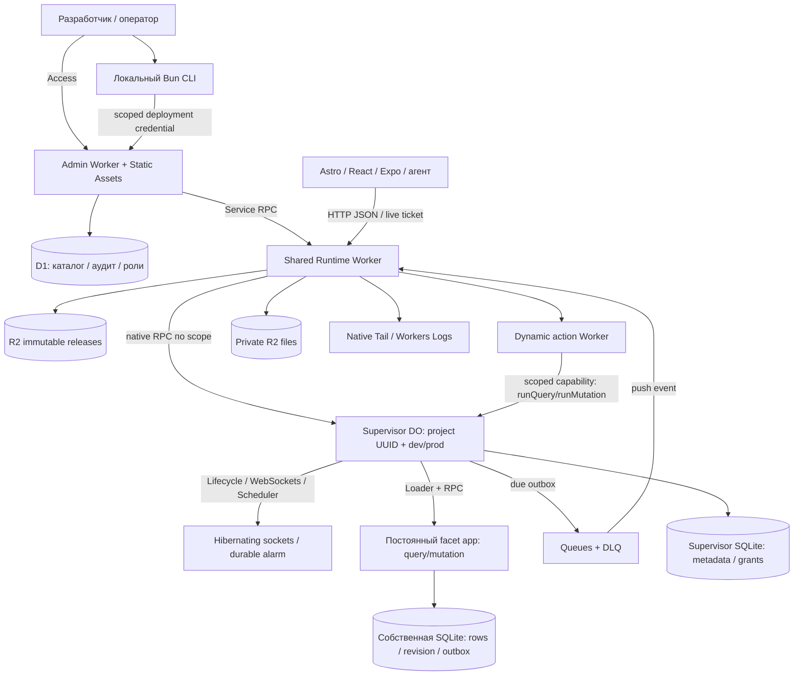

# Flared: карта реализации, решений и экономного выполнения

**Проверено по исходникам: 11 октября 2026 года.** Сопоставлено с [картой Cloudflare](cloudflare-capability-map.md). Это описание breaking native-data preview 0.3 и отдельно отмеченных незавершённых возможностей, **не декларация завершённой production-приёмки**.

## 1. Решение в одном абзаце

Две общие точки исполнения — Admin и Runtime — обслуживают независимые проекты и cloud `dev`/`prod`. Online dashboard статический; D1 содержит control plane. Каждая среда имеет адресуемый supervisor DO и постоянный динамический facet `app` с отдельной SQLite. Код/файлы лежат в R2. Live работает через hibernating WebSocket. Jobs доставляются нативной Queues после транзакционного outbox; alarms/Scheduler запускают отложенные и cron-события. **Ни одного выделенного постоянно работающего сервера на проект здесь не требуется.**

Базовый выбор хорошо соответствует нескольким независимым магазинам/CRM/приложениям. Обычный статический лендинг не обязан подключать Flared: Astro Static Assets достаточно, backend нужен только для данных/форм/кабинета.

## 2. Топология текущего кода



- **Не** Worker и D1 на каждый клиентский проект. Число сред влияет на DO state и daily Dynamic creations, а не на постоянно выделенные VM.
- Browser/app получает URL среды и свои auth credentials. Cloudflare administrative token и общие R2/D1 bindings не выдаются приложению.
- Dashboard можно закрыть: текущие app queries/live/jobs не обращаются к нему для каждого вызова. D1 не находится в основном app data path. Новые deployments/CLI approval — control plane, которому Admin нужен.
- Локально frontend, SDK и CLI/watch. Нет local dashboard и постоянно работающего cloud-dev эмулятора в production.

## 3. Каждое решение → нативная возможность Cloudflare

**Есть** — найдено в исходниках/config; **частично** — есть ядро, но есть незакрытые границы; **план** — пока не подключено. Обоснование — архитектурный вывод, а не измеренное превосходство в latency/цене.

| Решение Flared                         | Карта Cloudflare                                                                                               | Состояние / место реализации                                                                                 | Почему подходит; что не добавляем                                                                                   |
| -------------------------------------- | -------------------------------------------------------------------------------------------------------------- | ------------------------------------------------------------------------------------------------------------ | ------------------------------------------------------------------------------------------------------------------- |
| Общий HTTP API Runtime                 | [CF-WORKERS](cloudflare-capability-map.md#cf-workers)                                                          | Есть: `packages/core/src/runtime.ts`                                                                         | Event compute; не контейнер и не Worker на проект                                                                   |
| Online-only dashboard                  | [CF-ASSETS](cloudflare-capability-map.md#cf-assets)                                                            | Есть: Astro/shadcn в `packages/core/dashboard`; Admin `ASSETS`                                               | Статический frontend; без SSR и отдельного постоянно активного UI сервера                                           |
| Каталог, roles, аудит, CLI credentials | [CF-D1](cloudflare-capability-map.md#cf-d1)                                                                    | Есть: `admin.ts`, `cli-login.ts`, D1 migrations                                                              | Административные SQL выборки; app traffic не делает D1 lookup каждый раз                                            |
| Изоляция project/dev/prod              | [CF-DO](cloudflare-capability-map.md#cf-do), [CF-FACETS](cloudflare-capability-map.md#cf-facets)               | Есть: supervisor по immutable scope, facet `app`                                                             | Нативная storage изоляция; не tenantId фильтр общей app-таблицы                                                     |
| Application code загрузка              | [CF-DYNAMIC](cloudflare-capability-map.md#cf-dynamic)                                                          | Есть: `LOADER.get()` в `runtime.ts`                                                                          | Стабильный release-key, сборка до запроса; нет runtime TypeScript compiler                                          |
| Update без потери app DB               | [CF-FACETS](cloudflare-capability-map.md#cf-facets)                                                            | Есть: `ctx.facets.abort("app", ...)`                                                                         | Постоянное имя storage. `delete()` не использовать при обычном релизе                                               |
| Query/mutation database                | [CF-SQLITE](cloudflare-capability-map.md#cf-sqlite)                                                            | Есть: `sdk/schema.ts`, `database.ts`, `cloudflare.ts`: native documents/indexes                              | Typed CRUD/keyset над native SQL; без ORM, SQL builder и JS full-table filtering                                    |
| Атомарная mutation                     | [CF-SQLITE](cloudflare-capability-map.md#cf-sqlite)                                                            | Есть: native transaction, revision/outbox + `sync`                                                           | Не эмулируем транзакцию через последовательность HTTP запросов                                                      |
| Read-only query                        | [CF-SQLITE](cloudflare-capability-map.md#cf-sqlite), [CF-EGRESS](cloudflare-capability-map.md#cf-egress)       | Есть: revocable read capability без SQL/write/session/storage, no egress                                     | SQL lexer не нужен: user functions не получают raw SQL capability                                                   |
| Ревизии и reactive snapshots           | [CF-WS](cloudflare-capability-map.md#cf-ws), [CF-SQLITE](cloudflare-capability-map.md#cf-sqlite)               | Есть: supervisor `broadcast/snapshot`, auth-aware dedup                                                      | Нативный WS не является SQL reactive engine; этот небольшой слой нужен                                              |
| ACK/slow-client/reconnect              | [CF-WS](cloudflare-capability-map.md#cf-ws)                                                                    | Есть: persisted subscriptions/attachments, SDK `client.ts`                                                   | Сдерживаем backlog; reconnect получает snapshot, не бесконечный буфер                                               |
| Lifecycle/readiness/recovery           | [CF-MODULES](cloudflare-capability-map.md#cf-modules), [CF-ALARMS](cloudflare-capability-map.md#cf-alarms)     | Есть: public modules Agents 0.28.0                                                                           | Не full AI Agent/MCP; публичные экспериментальные modules, версии фиксированы                                       |
| Actions без прямой SQLite              | [CF-DYNAMIC](cloudflare-capability-map.md#cf-dynamic), [CF-RPC](cloudflare-capability-map.md#cf-rpc)           | Есть: role `action`, `AppCapability`                                                                         | Узкие runQuery/runMutation/files/schedules capabilities, не общий storage binding                                   |
| Outbound actions                       | [CF-EGRESS](cloudflare-capability-map.md#cf-egress)                                                            | Есть: scoped native `AppOutbound`; default deny                                                              | Exact HTTPS hosts, bounded stream/deadline, no redirects/TCP; provisioning/cloud gate открыт                        |
| Core secret / app secrets              | [CF-SECRETS](cloudflare-capability-map.md#cf-secrets)                                                          | Есть native `.get()` через scoped Secrets Store mapping; binding опционален                                  | Operator binding/policy; dashboard provisioning ещё нет, пароли в SQL не храним                                     |
| Межкомпонентный API                    | [CF-RPC](cloudflare-capability-map.md#cf-rpc)                                                                  | Есть: AdminControl/RuntimeControl + native facet RPC                                                         | Capability boundaries вместо публичных account API calls                                                            |
| Browser auth / admin auth              | [CF-ACCESS](cloudflare-capability-map.md#cf-access), [CF-WORKERS](cloudflare-capability-map.md#cf-workers)     | Есть: Access + `security.ts` RS256/JWKS/origin/membership                                                    | Access защищает admin, не app users. App JWT verification использует Web Crypto                                     |
| Ограничения abuse                      | [CF-RATELIMIT](cloudflare-capability-map.md#cf-ratelimit), [CF-EGRESS](cloudflare-capability-map.md#cf-egress) | Частично: native rate limit, payload/subscription limits, core/Dynamic CPU 1000 ms                           | Local rate limiting не строгий global cost ceiling; native role limits заданы; real-cloud enforcement ещё проверить |
| Immutable releases / aliases           | [CF-R2](cloudflare-capability-map.md#cf-r2), [CF-DYNAMIC](cloudflare-capability-map.md#cf-dynamic)             | Есть: `release.ts`, `routing.ts`, R2 builds                                                                  | R2 blobs достаточно; Artifacts/Git hosting не обязательны                                                           |
| Files streaming                        | [CF-R2](cloudflare-capability-map.md#cf-r2), [CF-RPC](cloudflare-capability-map.md#cf-rpc)                     | Есть: `files.ts`, stream API, private prefix                                                                 | До 10 MiB без полной буферизации; storage/auth metadata раздельны                                                   |
| File grants / cleanup                  | [CF-ALARMS](cloudflare-capability-map.md#cf-alarms), [CF-SQLITE](cloudflare-capability-map.md#cf-sqlite)       | Есть: supervisor metadata, scoped temporary grants                                                           | Согласованность SQL↔R2 требует recovery, не отдельный постоянно работающий cleanup Worker                           |
| Background action jobs                 | [CF-QUEUES](cloudflare-capability-map.md#cf-queues)                                                            | Есть: outbox → `JOBS`, push consumer, retries/DLQ                                                            | Нативный broker. Receipt не гарантирует exactly-once внешнего side effect                                           |
| Delayed jobs / dynamic cron            | [CF-MODULES](cloudflare-capability-map.md#cf-modules), [CF-ALARMS](cloudflare-capability-map.md#cf-alarms)     | Есть: Scheduler, persisted dueAt, UTC cron                                                                   | Delay до года выходит за Queue delay до 24h. Не свой cron parser и не platform cron на каждый project               |
| Долгие многошаговые processes          | [CF-WORKFLOWS](cloudflare-capability-map.md#cf-workflows)                                                      | Не подключено                                                                                                | Workflows лучше при реальной orchestration; для простого job это лишний слой                                        |
| Логи функций                           | [CF-OBSERVABILITY](cloudflare-capability-map.md#cf-observability)                                              | Частично: DynamicTail → console/Workers Logs; UI читает durable error/write summaries и ephemeral query ring | Не строим свою log platform. UI Logs не выдаём за весь Cloudflare log dataset                                       |
| Метрики account / app                  | [CF-ANALYTICS](cloudflare-capability-map.md#cf-analytics)                                                      | План: SQL/Analytics Engine bindings отсутствуют                                                              | Native datasets вместо periodic D1 usage collector; недоступность отображать явно                                   |
| Экспорты/восстановление                | [CF-R2](cloudflare-capability-map.md#cf-r2), [CF-SQLITE](cloudflare-capability-map.md#cf-sqlite)               | План; готовый export/import API в текущем runtime не найден                                                  | Цель: export в R2, restore в пустую среду; independent facet PITR не обещаем                                        |
| Core deploy / SDK compilation          | [CF-TOOLING](cloudflare-capability-map.md#cf-tooling)                                                          | Есть: Bun builds + vendor Wrangler/Node; `.github/workflows/ci.yml`                                          | Сборка при изменениях, не на app request. Новый `cf` beta пока не заменяет тестированный toolchain                  |
| Короткие URL среды/dashboard           | [CF-DOMAINS](cloudflare-capability-map.md#cf-domains)                                                          | Есть: custom domains/aliases, runtime UUID scope                                                             | Alias не переиспользуется для чужого tenant; vanity URL не меняет storage identity                                  |

### Что Cloudflare НЕ предоставляет автоматически

Документные validators приложения, auth-aware query cache, commit→live инвалидирование, SQLite↔Queue outbox, релизный журнал schema/code и scoped R2 grants — это **не готовые встроенные функции Cloudflare**. Нужен небольшой Flared слой.

Удаление его ради «нулевой обвязки» потеряет correctness/изоляцию. Не нужен противоположный край: перенос полного Convex Rust backend, собственного broker, object storage, distributed read-set engine или общей ORM-платформы. [Предыдущий аудит с сопоставлением Convex](architecture-audit-0.3.md).

## 4. Реальные пути выполнения и billable amplification

### Query

```text
Client → Runtime (route/origin/JWT) → Supervisor → Loader/facet → SQLite → JSON
```

Холодный short alias может читать R2; положительные alias mappings кешируются в isolate (ограничение 256). Cached routing не является кешем результатов БД. При eviction cache восстанавливается по запросу. Runtime startup, Dynamic startup, DO request/SQL и execution — разные счётчики. D1 здесь не нужен.

### Mutation и live

```text
Supervisor: persisted recovery marker + alarm
  → facet transaction(data + revision + outbox)
  → commit/sync
  → due jobs dispatch + auth-aware live recalculation
  → mutation response / live snapshots
```

Mutation **ждёт** `recover()`/broadcast до ответа. Пересчитываются уникальные active queries, чьи table dependencies затронуты после последнего пересчёта; new release пересчитывает все. Неизменившиеся результаты не отправляются. Table revision map commit-ится с данными, dependencies переживают hibernation; stale ACK получает последний snapshot. Это не Convex read-set/index-range invalidation. Дедупликация включает авторизацию, чтобы не смешать чужие результаты. Чем больше разных активных queries и writes, тем больше SQL/CPU; 100 соединений с одинаковым query могут быть дешевле 100 разных, но auth scope ограничивает dedup.

### Action/job

```text
SQL outbox → persisted dueAt/alarm → Queue → push consumer → Dynamic action
                                                   → capability → query/mutation при необходимости
```

One-shot action не требует Workflows. Queue retries и внешние side effects должны иметь business idempotency key. Build остаётся, пока job ссылается на его release. Для сообщения в одну billing-size unit типичная доставка — write/read/delete, то есть около **3 Queue operations**, плюс compute consumer/action/DB. Batch снижает число consumer invocations, не число message operations. [Queues pricing](https://developers.cloudflare.com/queues/platform/pricing/).

### File upload

```text
Authorized grant → Runtime streaming → private R2 object
                 → supervisor final metadata / recovery при сбое
```

Files не проходят через job queue как основной transport. «Queued» в UI не равно Queue job. Upload означает R2 write + metadata updates и временную работу stream handlers. Незавершённые streams не должны держать DO бесконечно; нужен timeout/failure testing. Grants одноразовые, ограничены scope/expiry; для mixed SQL/R2 возможна неопределённость финализации, поэтому recovery нельзя удалить.

### Dashboard

```text
Access → Admin script → identity/membership D1 → static assets или control API
```

В **текущем** config `assets.run_worker_first: ["/*", "!/_astro/*"]`. Поэтому HTML/API/bootstrap проходят Admin script/auth, но публичные hashed JS/CSS идут напрямую asset-first без membership lookup. После загрузки панель делает fetch выбранного раздела / manual refresh; периодического `setInterval` polling нет.

## 5. Матрица сна: как платформа работает 24/7 без compute 24/7

| Сценарий                             | Что остаётся                                      | Что пробуждает / расходует usage                                 | Ожидаемая политика                                                                               |
| ------------------------------------ | ------------------------------------------------- | ---------------------------------------------------------------- | ------------------------------------------------------------------------------------------------ |
| Проект создан, нет клиента/jobs/cron | SQLite, release metadata, R2                      | Только новые обращения/control operations                        | Не keep-warm, не создаём background job «для здоровья»                                           |
| Cloud dev не используется            | Отдельные dev данные/релиз                        | CLI redeploy, клиент, оставленные dev cron/jobs                  | Закрыть client/watch; cron отдельно pause. Нельзя считать dev бесплатным при активном расписании |
| Live socket подключён, изменений нет | Physical socket + durable auth/subscription state | Subscribe/ACK/reconnect/auth-expiry alarms, а не постоянный tick | Hibernation; отсутствие keepalive loop                                                           |
| Запись при активных подписках        | Commit, recovery state                            | Mutation, live query recalculation, SQL, sends                   | Бounded queries/dedup/ACK, не все данные каждой таблицы                                          |
| Отложенное задание через сутки       | Stored outbox/dueAt/build reference               | Alarm в момент due, Queue/action                                 | Не `await sleep(сутки)` и не постоянный poller                                                   |
| Cron раз в минуту                    | Cron definition                                   | Каждая минута даже без users                                     | Только явно включённые расписания, разумная частота                                              |
| Загружается файл                     | R2 stream + grants                                | Активный stream и SQL финализация                                | Завершить/оборвать по лимиту; bounded cleanup                                                    |
| Dashboard закрыт                     | Assets + D1 + deployed Admin                      | Нет UI fetch; отдельные jobs/runtime продолжают свою работу      | Dashboard не monitoring daemon                                                                   |
| Dashboard открыт без действий        | Browser UI                                        | Первоначальные запросы, явный refresh                            | Скрытые вкладки не опрашивают API                                                                |
| Core/platform update                 | Новые bundles/assets                              | Build/deploy/migrations; после них обычный event mode            | Не перестраивать платформу для каждой app mutation                                               |

**Нулевой app traffic не всегда означает ноль событий:** auth expiry, последний recovery alarm, cleanup, оставленный cron или retry после аварии — реальные причины пробуждения. Они должны быть конечными/обусловленными задачей, а не постоянным циклом.

В исходнике runtime нет постоянного interval. У Lifecycle есть кратковременные watchdog/abort таймеры при обработке событий; это не утверждение «во всех зависимостях нет ни одного setTimeout». Отсутствие постоянного таймера и физическая cloud hibernation — разные доказательства; физическая hibernation с новым boot ID подтверждена текущей cloud-приёмкой; duration/billing измеряются отдельно.

## 6. Loader, холодный старт и цена версии

Текущий ключ:

```text
project/environment scope : release hash : abi4 : policy digest : compatibility date : facet|action
```

- Нет request ID, access token, user ID. Повторные requests одной роли/версии не создают новую daily-unique единицу каждый раз.
- Build до runtime request; небольшие bundles и lazy action role снижают startup work. Не грузить action-код, когда есть только queries.
- App DB не зависит от hash runtime: facet identity остаётся `app`. Update не равен delete/recreate storage.
- Non-secret scoped capability policy хешируется Web Crypto на startup supervisor; digest входит в loader key. Bindings меняются отдельным core deploy. In-memory bounded metadata cache до 4 MiB исчезает при hibernation и не держит объект awake.
- Нельзя объединить разные project IDs ради уменьшения creations: экономия не оправдывает потерю изоляции.

### Модель для 10 проектов, 31 день — не фактический счёт

Если **каждый день** используются обе среды и обе runtime роли:

```text
10 projects × 2 environments × 2 roles × 31 days = 1,240 daily-unique units
(1,240 − 1,000 included) × $0.002 = $0.48 creations overage
```

Если prod обеими ролями используется 31 день, а dev только 10 дней:

```text
10 × 2 prod roles × 31 + 10 × 2 dev roles × 10 = 820 units
```

Это только creations. Дополнительные релизы в один день, config variants и jobs на старых builds увеличат счётчик; неиспользуемая роль его не увеличит. Requests/CPU/DO/SQL/files/logs считаются отдельно. **1000 — сумма daily uniqueness за месяц, не 1000 навсегда бесплатных проектов.** [Dynamic pricing](https://developers.cloudflare.com/dynamic-workers/pricing/).

Hibernation может добавить cold constructor/readiness latency. Не обещаем её равной тёплому вызову, но не платим за keep-warm без измеренного требования. Кешируем bounded immutable metadata в heap; всё, необходимое для correctness, остаётся durable. Первое измерение — cold/warm отдельно, не только средний p95.

## 7. Почему DO hibernation важнее микроптимизации кода

Иллюстрация по allocation **0.128 GB**, используемой в pricing-примерах Cloudflare:

```text
Один DO активен непрерывно 31 день:
31 × 86,400 × 0.128 = 342,835.2 GB-s

10 DO активны непрерывно:
3,428,352 GB-s > 400,000 included GB-s

10 DO активны суммарно 1 секунду в каждой минуте:
10 × 31 × 1,440 × 1 × 0.128 = 57,139.2 GB-s (~14.3% included)
```

**Не измерение текущего Flared.** GB-s считаются по тарифной allocation, не фактическому heap. Concurrent events одного объекта не надо бездумно умножать по wall-clock; accounting facet/native RPC проверять на реальном usage. Overage округляется по правилам Cloudflare. [DO pricing](https://developers.cloudflare.com/durable-objects/platform/pricing/).

Следствие: нельзя держать обычный WebSocket `accept()` или бесконечный timer и надеяться, что «JS почти ничего не делает» решит цену. С другой стороны, **не закрываем healthy hibernating WebSocket каждую минуту**: это создаёт reconnect/auth/SQL работу и ухудшает live latency.

## 8. Big Bang 0.3: что применено и что осталось

| Задача                                           | Текущее состояние                                                                                                                                         | Граница / дальнейшая проверка                                                                                                             |
| ------------------------------------------------ | --------------------------------------------------------------------------------------------------------------------------------------------------------- | ----------------------------------------------------------------------------------------------------------------------------------------- |
| Drizzle / SQL migration generator / ABI fallback | Удалены: native document schema, CRUD, scalar indexes и keyset                                                                                            | Несовместимый ABI 4; нужна новая среда/установка, не auto-reset старых данных                                                             |
| Общая table validation                           | App CRUD и dashboard edits используют один validator; system fields защищены                                                                              | Проверено local/workerd и actual cloud admin CRUD/live/revision conflicts                                                                 |
| Query readonly boundary                          | Нет raw SQL/write/session/storage, capability revocation; no egress                                                                                       | Не переносим полный Convex engine; доверенный код команды                                                                                 |
| Live SQL amplification                           | Table dependency invalidation, durable table revision map, auth-aware dedup                                                                               | Подтверждён пропуск unrelated writes в real-core local test; нужен cloud нагрузочный замер                                                |
| Egress / secrets                                 | Native gateway и Secrets Store `.get()`, operator policy/bindings                                                                                         | Dashboard write-only provisioning и реальные bindings ещё не проверены в cloud                                                            |
| Outbox / history retention                       | Outbox удаляется после Queue ack; receipts и completed/failed jobs — 30 дней; release metadata GC защищает active/candidate/outbox/queued/failed-job refs | SQL cleanup bounded/on-traffic. Scoped R2 prefixes позволяют удалять только собственные blobs после reference checks, без общего registry |
| Пустые recovery/expiry wakes                     | Public Lifecycle cancel после успешного recover без jobs / закрытия последнего socket                                                                     | Real-core local proof: quiet environment имеет `alarm=null`, jobs пусты; физическая cloud idle duration ещё не измерена                   |
| Dynamic budgets                                  | Native CPU 1000 ms, facet subrequests 0, action 100; max DB ops/jobs/doc/page/cursor                                                                      | Не общий потолок bill; реальные пределы аккаунта/нагрузки надо проверить                                                                  |
| Tail / auth cost                                 | Пустые successful Tail events пропускаются; payload bounded; JWKS single-flight, rotation cooldown и imported-key cache                                   | Sampling=1 сохранён; не скрывать ошибки ради красивой цены                                                                                |
| Assets                                           | Worker-first сохранён для Access/CSP/membership                                                                                                           | Asset-first только после edge protection/hostnames проверки; никакого silent auth bypass                                                  |
| Queue batching                                   | Batch=1/timeout=1 сохранены для latency; native retries/DLQ                                                                                               | Burst batching только после замера, не путать invocation и message operations                                                             |
| Analytics / export / installer                   | Не реализованы; UI не имитирует здоровую телеметрию                                                                                                       | Это отдельные продуктовые/cloud acceptance gates, не legacy compatibility                                                                 |

Текущая приёмка 11 октября: 256 unit tests, 39 native checks и 16 коротких cloud platform checks PASS. Обновлены Core и test dev/prod; проверены физическая hibernation, 1002 документа, R2/Queues/cron и dashboard upload. 30.40-minute/100-client soak — PASS; точная стоимость не выводится из этих counts. Актуальная карта закрытых A–F и открытых G–H: [аудит](architecture-audit-0.3.md).

### Почему document adapter, а не ещё один ORM

`defineTable(z.object(...)).index(...)` даёт один контракт данных. Под ним **отдельные native SQLite tables**, JSON extension и native expression indexes, а не одна tenant JSON-таблица. Nested/optional/defaulted values не требуют SQL journals на каждое поле; type/input/output validation, ordering и keyset остаются ограниченными и явными. SQLite, транзакции, Durable Object isolation и alarm ownership не заменяются собственными реализациями.

Реальная цена JSON serialization/indexes и startup нового runtime измеряется отдельно. Удаление Drizzle не само по себе доказательство latency/стоимости. Compatibility adapter отсутствует по явному решению разработки. При первоначальном local прогоне cloud resources не стирались; последующий явно разрешённый Big Bang удалил старый data namespace и обновил облако. Подробнее — [native API и границы](architecture.md).

## 9. Что сознательно не включаем в minimum

| Сервис / механизм                                         | Решение                                             | Условие пересмотра                                                                   |
| --------------------------------------------------------- | --------------------------------------------------- | ------------------------------------------------------------------------------------ |
| Containers/Sandboxes                                      | Не нужны для JS data/functions core                 | Native binaries/Linux/untrusted agent execution; session shutdown и отдельный бюджет |
| K2                                                        | Не вместо Queues                                    | Replayable event log с несколькими независимыми consumers                            |
| Basin / AI Search                                         | Нет обязательного background indexing/maintenance   | Большая OLAP/RAG задача конкретного приложения                                       |
| KV / Hyperdrive / внешний MySQL                           | Не дополняем SQLite просто ради списка возможностей | Remote/read-mostly config или существующая external DB requirement                   |
| Workflows / Dynamic Workflows                             | Не слой поверх каждого одношагового job             | Долгая многошаговая orchestration с retries/events                                   |
| Realtime SFU/Kit/TURN/MoQ                                 | Не транспорт app live queries                       | Audio/video/media продукт                                                            |
| Artifacts / Flagship                                      | Не обязательны для release/blob storage             | Git-agent workspaces / feature flags, отдельное обоснование                          |
| Full Agent/MCP runtime                                    | Не нужен для query/mutation                         | Agent feature с собственным bounded workload                                         |
| Keep-warm / periodic health SQL / постоянный queue poller | Не добавлять                                        | Только доказанный бизнес-SLO; сначала нативные metrics/alerts                        |
| Автоматическое шардирование / межпроектные транзакции     | Не реализовано                                      | Доказанный hot-tenant предел; это отдельный архитектурный этап                       |

Все альтернативы и их текущие статусы — в [Cloudflare карте](cloudflare-capability-map.md), а не старом списке возможностей 2022 года.

## 10. Политика бюджета без потери производительности

1. **Одна платформа, scope isolation, on-demand execution.** Не держать 20 процессов для 10 проектов × dev/prod.
2. **Live только при подписке.** SDK закрывает последнее unused соединение; hibernation сохраняет healthy socket. Не data polling.
3. **Cron по явному согласию.** Один minute cron за 31 день — **44,640 запусков**, hour cron — 744; это до Queue/action/SQL amplification. Для ежедневного business task не выбирать минутный cron.
4. **Dev тоже ограничен.** Закрытый browser не отменяет уже включённый dev cron. При pause не удалять данные и не терять оплаченные/заказанные jobs; policy pause/cancel требует явной семантики.
5. **Queries bounded и indexed.** LIMIT без хорошего index не гарантирует малое rowsRead. Не full-table scans и не JS filtering всей базы ради удобного SDK.
6. **Uploads streaming, immutable builds кешируются.** Файлы не буферизуются целиком и не проходят через Queue bytes. Expired grants/failed uploads очищать bounded.
7. **Сборки — локально/CI, только при backend changes.** Фронтенд edit не должен каждый раз создавать backend release; no runtime compilation.
8. **Нативные логи/metrics с ограниченными payloads и retention.** Не записывать каждую метрику и полный Tail stream в app SQLite. Декабрьский billing change — отдельная точка пересмотра.
9. **CPU/resource limits + rate policy + alerts.** Подписка $5 не является stop-loss. Не ставить loop «проверить баланс каждую секунду»; account alerts и явные периодические отчёты дешевле.
10. **Изменение только после замера.** Цель — меньше ненужных wakes/SQL, а не максимальная задержка batching или агрессивное закрытие sockets ради красивого счётчика.

## 11. Приёмка экономичности и качества

Тесты выполнять ограниченными по времени прогонами, не оставлять load clients/cron навсегда. Создавать отдельные ресурсы, не сбрасывать пользовательские среды.

| Проверка                          | Как доказать                                                                             | Критерий                                                                                    |
| --------------------------------- | ---------------------------------------------------------------------------------------- | ------------------------------------------------------------------------------------------- |
| Тихая среда без clients/jobs/cron | Метрики до/после фиксированного окна; исключить operator traffic                         | Нет постоянной лестницы alarm/invocations; storage остаётся и учитывается                   |
| Idle hibernating live             | Открыть native WS, закончить handlers, измерить DO duration; принудительный cold restart | Socket жив и восстанавливает auth/subscriptions; duration не накапливается как always-awake |
| Cold/warm query/mutation          | Одни и те же данные/регион/сеть; separate first-use и steady-state                       | Отдельно p50/p95/p99, CPU/startup, rowsRead/Written; latency не выдаётся за CPU             |
| Live нагрузка                     | 100 clients, ≥1000 rows, 30 минут, одинаковые/разные auth queries                        | Delivery p95 vs сопоставимый baseline; ack/reconnect/expired-auth/slow-client без backlog   |
| Jobs/recovery                     | One-shot, delayed, cron; crash до/после commit/send/effect/receipt; retries/DLQ          | Нет потери committed jobs; at-least-once и external idempotency явно проверены              |
| Release/изоляция                  | Два проекта × dev/prod, facet update, failed migration, interrupted activation           | Нет чужих данных; данные не стираются при code update; rollback SQL работает                |
| Files                             | Streaming success/failure, wrong scope/origin/grant/size, metadata recovery              | Нет открытого prefix/утечки; незавершённая загрузка не вызывает вечные retries              |
| Assets оптимизация                | Сравнить script requests/D1 lookups до/после в отдельном dev                             | Снижение amplification без потери Access/CSP/roles; иначе не выпускать                      |
| Месячная экономика                | Account Billable Usage + service datasets, начала/концы периодов, shared allowance       | Таблица всех meters; estimate отдельно от invoice, с retry/deploy/headroom                  |

**Что уже проверялось в предыдущем локальном аудите:** 193 unit tests и 16 native kernel проверок прошли. Kernel harness — локальный workerd и тестовые классы, не физическая hibernation или cloud billing deployed core. Ориентир 98 ms live p95 — старый короткий runtime тест, не подтверждённый результат этого стека.

**Обновление 0.3:** breaking rewrite native data/SDK/CLI/core/dashboard; scope/resource/Cloudflare maps согласованы с новым кодом. Актуальные результаты unit/build/tarball/core native tests записываются в local acceptance reports. Следующий явно разрешённый Big Bang обновил Admin/Runtime и test dev/prod, удалив старые данные без backup; billing plan, домены и Access policy не менялись. Physical cloud hibernation подтверждена, длительные idle/load/cost measurements и полный production gate остаются работой приёмки; «production-ready» ими пока не подтверждено.

## 12. Навигация по исходникам и версиям

| Файл / папка                                                 | Роль                                                                                                |
| ------------------------------------------------------------ | --------------------------------------------------------------------------------------------------- |
| [`runtime.ts`](../packages/core/src/runtime.ts)              | Supervisor, loader, live/recovery/jobs, DynamicTail и scoped capabilities                           |
| [`admin.ts`](../packages/core/src/admin.ts)                  | Access, D1 membership/audit/control, static asset выдача                                            |
| [`files.ts`](../packages/core/src/files.ts)                  | Streaming/grants/metadata recovery/private file scope                                               |
| [`routing.ts`](../packages/core/src/routing.ts)              | UUID/alias routes и bounded positive cache                                                          |
| [`release.ts`](../packages/core/src/release.ts)              | Проверка release bundles/manifest/schema                                                            |
| [`security.ts`](../packages/core/src/security.ts)            | JWT/JWKS, scope/origin/input boundaries                                                             |
| [`SDK cloudflare.ts`](../packages/sdk/src/cloudflare.ts)     | Facet SQLite, transaction/revision/outbox, admin DB adapter                                         |
| [`SDK server.ts`](../packages/sdk/src/server.ts)             | Функции, context и validators                                                                       |
| [`SDK client.ts`](../packages/sdk/src/client.ts)             | Portable JS client, live transport/reconnect/cleanup                                                |
| [`CLI`](../packages/cli/lib)                                 | Build/login/project/watch/deploy, не облачный daemon                                                |
| [`Dashboard`](../packages/core/dashboard/src/components)     | Семь разделов, lazy views, on-demand refresh                                                        |
| [`Runtime config example`](../runtime.wrangler.example.json) | Loader/DO/R2/Queues/limits/observability bindings                                                   |
| [`Admin config example`](../admin.wrangler.example.json)     | Static Assets/D1/RPC/Access config; worker-first для protected routes; hashed UI assets asset-first |

Зафиксированные сейчас локальные версии: Bun 1.4.3, Wrangler 4.149.0 (Node 24 vendor tooling), Agents 0.28.0, Astro 7.3.8, React 19.3.0, TypeScript 6.0.2; compatibility date примеров — **2026-10-10**. Это прочитанные версии repository, не заявление «все latest в registry». Upgrade compatibility date может менять поведение runtime и требует regression/cloud tests.

**Итог:** фундамент уже on-demand и преимущественно нативный. Основные риски расходов — не число опубликованных проектов, а активные DO, частота writes/live/cron, daily versions, ненужные script-first assets, retries и неограниченная retention. Сначала устранять эти измеримые причины; не добавлять новые cloud сервисы ради новизны.
